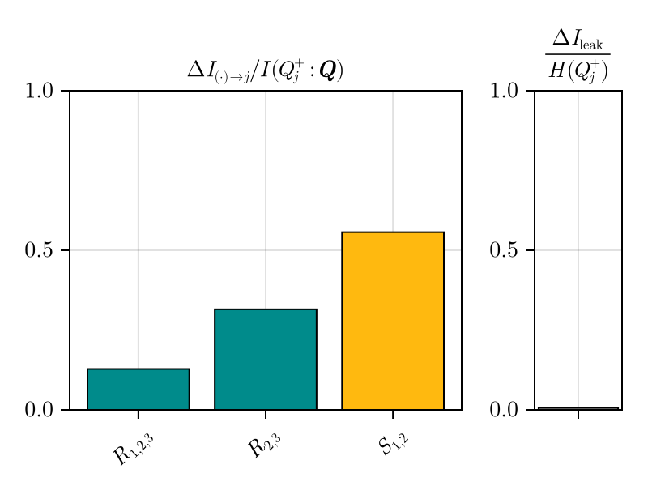

```@meta
CurrentModule = SURD
```

# SURD

Documentation for [SURD](https://github.com/tkrhsmt/SURD.jl).
SURD (Synergistic-Unique-Redundant Decomposition) is a Julia package for performing SURD decomposition on multivariate time series data.

## Installation

You can install SURD.jl using Julia's package manager. Open the Julia REPL and run the following commands (press `]` to enter the package manager):

```julia
add https://github.com/tkrhsmt/SURD.jl
```


## Usage

After installing the package, you can use it in your Julia scripts or REPL as follows:

```julia
using Random, SURD

# Example data
rng = MersenneTwister(42)
Q1 = zeros(100000)
Q2 = zeros(100000)
Q3 = zeros(100000)

# Initialize the time series with some random values
Q1[1] = randn(rng)
Q2[1] = randn(rng)
Q3[1] = randn(rng)

# Generate synthetic time series data
for i in 2:100000
    Q1[i] = 0.3*Q1[i-1] + sin(Q2[i-1] * Q3[i-1]) + 0.001 * randn(rng)
    Q2[i] = 0.5 * Q2[i-1] + 0.1 * randn(rng)
    Q3[i] = Q2[i]
end

# Perform SURD decomposition
# (Q1, Q2, Q3) -> Q2^+
result = surd(Q1[2:end], (Q1[1:end-1], Q2[1:end-1], Q3[1:end-1]), SURD.kNN(); log=true)

```

`SURD.Histogram()` uses StatsBase's automatic bin selection. To use a fixed
number of bins per variable, pass a positive integer to `SURD.Histogram`.

```julia
result = surd(Q1[2:end], (Q1[1:end-1], Q2[1:end-1]), SURD.Histogram(; nbins=16))
```

## Continuous data

Pass a nearest-neighbor method for continuous observations. Each vector is a
scalar series. Use a matrix with observations in columns for a vector-valued
series.

```julia
continuous = surd(Q1[2:end], (Q1[1:end-1], Q2[1:end-1]), SURD.kNN(; k=5))
```

Both methods return the component fractions under `"u"`, `"r"`, and `"s"`,
and the leak under `"leak"`. The component fractions sum to one when the
estimated total is positive. If the total is zero, all component fractions
are zero. The kNN leak is `exp(-2 * I_total / d_Y)`, computed using the
total before normalization in nats and the target dimension `d_Y`.

## Visualization

Install CairoMakie in the same Julia environment (`add CairoMakie` in the
package manager). Loading CairoMakie activates SURD's plotting extension.
Pass the `result` from the 16-bin example above to `surd_plot` to create a
Makie figure.

```julia
using CairoMakie

fig = surd_plot(result; size=(680, 320))
save("surd_decomposition.png", fig)
```

The left panel shows the component fractions greater than the default threshold
of `0.01`. The right panel shows the leak.


